<h1 align="center">
  &nbsp;What-skills-am-i-using
</h1>

<p align="center">A Claude Code mod that shows which skills, plugins, subagents and MCP tools the current conversation has used.</p>



## Install

Type this at the prompt of a terminal `claude` session:

```
/plugin install what-skills-am-i-using --marketplace DannyW618/What-skills-am-i-using
```

Answer `y` to add the marketplace, then pick a scope. There is nothing to configure.

## What you see

One line above the prompt, once the conversation has used something:

```
◢◤ humanizer → ponytail → navigate → read_page → Explore :.     3 skills · 1 subagent · 2 MCP tools  [ Show ]
```

Press **Show** for the full order and one row per plugin or MCP server:

```
╭──────────────────────────────────────────────────────────────────────────╮
│ order: humanizer → ponytail → navigate → read_page → Explore             │
│ Built-in subagents           :. Explore ×2                               │
│ claude-in-chrome  MCP server ✗ read_page ×2 (1 failed)  ✓ navigate ×4    │
│ ponytail          plugin     ✓ ponytail ×3                               │
╰──────────────────────────────────────────────────────────────────────────╯
```

| Mark | Meaning |
| --- | --- |
| `a → b → c` | the order of use, oldest to newest |
| **bold orange** with `:.` dots | in use right now |
| `✓` | used, no failures |
| `✗` | at least one call failed |
| `×3` | used three times (no number means once) |

Long sessions stay compact: the first line keeps the last 8 names, the open box keeps the last 30, and each row shows its 10 most recent entries. `/what-skills` prints everything.

## What it counts

| What | How it is noticed |
| --- | --- |
| Skills Claude invokes | calls to the `Skill` tool |
| Skills you type (`/name`) | slash commands that are not built in |
| Subagents | calls to the `Agent` tool, by agent type |
| MCP tools | any tool named `mcp__server__tool` |

## Command

- `/what-skills` prints the full list as a tree.
- `/what-skills reset` clears the counts.

## Good to know

- "In use" is a best guess for skills. The mod sees a skill being loaded, not whether Claude keeps following it, so a skill counts as in use until the turn that loaded it ends.
- It only watches. It never blocks or changes a tool call.
- It writes nothing to disk and sends nothing over the network. The counts cover the current conversation and go away on `/clear`.
- Built and tested on Claude Code 2.1.295. The mod API is early access and may change between releases.

## License

[MIT](LICENSE)
